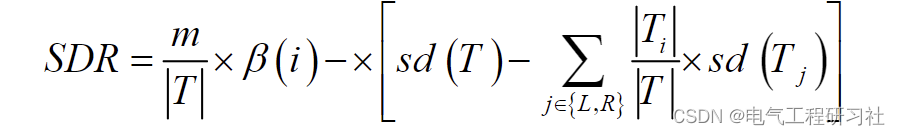
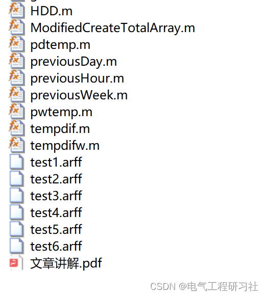

# Model Tree Short-Term Load Forecasting Based on Machine Learning (Matlab Code Implementation)

​  
2. In the first phase of constructing model trees (R5P), mathematical models use decision tree algorithms with different splitting criteria. Instead of selecting attributes that maximize information gain, they select attributes that minimize changes within subsets to build R5P trees. The formula used to find splitting attributes is called Standard Deviation Reduction (SDR).
In which T is the set of all examples that reach a specific node, and Ti, i = 1,2,..., are the sets of sub-examples generated from splitting at this node. The splitting stops when the calculated SDR value is very small or only a few instances remain. This algorithm also applies to missing values. Considering missing values, the formula for calculating SDR above is modified as follows:
Editor
See Part 3 for the detailed mathematical model.
3. Matlab code and detailed explanation of the article. This article only displays a part of the code, all codes can be found in:
Editor
​  

## Images

<!-- PAYMENT_BLOCK -->

## Get this dataset

- Payment link (Stripe): [Buy now](https://buy.stripe.com/3cs8yP7sY87d0vu9AB)
- Payment QR code: 

<!-- /PAYMENT_BLOCK -->
